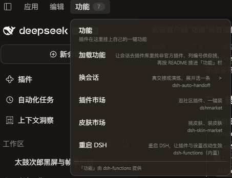

# dsh-functions

给 **DeepSeek Harness** 客户端顶端加一个可扩展的 **「功能」** 标签：
插件注册进来的一键功能都在这儿，用户不用再记着「去哪儿点 / 输入什么口令」。

> **0.4.0 起这个包自带「重启 DSH」** —— 装这一个包，功能栏里就有「重启 DSH」（两级确认，有任务在跑会拦一下）；
> 不再需要单独安装 `dsh-function-restart`（已并入本包，见下面「一键重启 DSH」一节）。

    [▢]  应用   编辑   功能 3 ▾
                      +----------------------------------------+
                      | 功能                                   |
                      | 插件在这里挂上自己的一键功能           |
                      | 加载功能        让会话去找非官方插件   |
                      | 读取当前会话    让当前窗口的会话读一次 |
                      | 换会话      >   真交接或演练，选一条   |
                      | 插件市场        逛社区插件、一键装     |
                      | 重启 DSH        重启 DSH，让设置生效   |
                      +----------------------------------------+

（示意图来自作者本机安装的一组插件；只装本包时，面板里有内置的「加载功能」和「重启 DSH」（0.4.0 起）。）

下面是真机截图（Windows 桌面版，装了本包 + 几个社区插件）：

**不 patch DSH 本体，不 require React，不引任何 Harness 客户端包** ——
它就是一个普通插件：一行 Loader 条目 + 宿主半边 + 一个自带样式的客户端 bundle。

## 装

DSH → 插件 → 添加插件，填这个包的路径（tarball 或解包目录都行），然后**重启 DSH**
（服务端不热更新；客户端那半边刷新页面就有）。

手动装也行：profile 的 `package.json` 里加一条依赖 + `dsh.profile.bundles` 一行，
再在 `node_modules` 里放一个指向它的 Junction/软链。

装好后插件页会用它包里的展示元数据（`locale/zh.json`、`locale/en.json` 里的
`meta.title` / `meta.description`）显示标题与描述，并显示包内的 `icon.svg`。
`package.json` 里对应的是顶层 `icon` 字段、`exports` 里的 `./locale/*.json`，
以及 `files` 里的 `locale/*.json` 与 `icon.svg`（0.3.1 起；0.4.0 起还带 `restart/` 的
图标与 locale，见下面「一键重启 DSH」一节）。

## 五行加一条功能（宿主半边，推荐）

    // 你自己的插件 index.js
    export const inject = ['functions'];

    export function apply(ctx) {
      ctx.functions.register({
        id: 'my.tool',
        title: '干点什么',
        description: '一句话说明\n它调用的插件名',   // 第二行惯例：写它依赖的插件
        group: '我的',
        order: 10,
        confirm: { title: '干点什么', message: '现在跑？' },
        async run() { return { message: '干完了' }; },
      });
    }

`run()` 返回的 `message` 会弹在界面上；返回 `{ warnAfterMs, warnMessage }` 的话，
到点还活着就再弹一条（给「重启这种会把自己关掉的功能」兜底）。

## 字段表

| 字段 | 类型 | 说明 |
| --- | --- | --- |
| `id` | string | **必填**，唯一。 |
| `title` | string | **必填**，菜单显示名。 |
| `description` | string | 说明。可以带换行：**第一行讲做什么，第二行写它调用的插件**（面板渲染两行，右对齐）。 |
| `group` | string | 分组，默认「通用」。只参与排序，标签默认不画。 |
| `order` | number | 组内排序，小在前，默认 100。 |
| `pinned` | boolean | **置顶**：永远排最上面（不受分组与 order 影响）。 |
| `parent` | string | 挂到某个父项的子菜单里（二级菜单）。写了它就不出现在顶层。 |
| `submenu` | boolean | 标记这一条是**二级菜单的父项**（容器）：自己没有动作，`run` 可以不写。 |
| `icon` | string | 预留（2026-10 之后面板不再显示单字图标，写了不报错）。 |
| `confirm` | object | 一级确认窗：`{ title, message, detail, confirmText, cancelText }`。 |
| `confirms` | array | 多级确认（静态）。只有第 0 级用得到。 |
| `prepare(stage, context)` | function | **动态**确认：第 N 级的文案在第 N-1 级点掉之后才算（「有没有任务在跑」这种话隔一次就会过期）。返回 `null` = 没有更多确认。 |
| `run(job)` | function | 执行。`job = { id, ctx, log, session, confirm, alert, toast, get, post }`。**不写 run 就必须写 `shell` 或 `submenu: true`。** |
| `shell` | object | 只想跑命令：`{ command, args, cwd }`，结果整理成一句话显示。 |
| `hidden` | boolean | 不进菜单（仍可用 API 调）。 |

二级菜单长这样（照 Windows 右键菜单的逻辑：悬停 120ms 展开、离开 180ms 收起，点父项也能展开）：

    ctx.functions.register({ id: 'family', title: '换会话', submenu: true, group: '会话' });
    ctx.functions.register({ id: 'family.go', title: '真交接', parent: 'family', run() {...} });

## config.functions：不写代码，在 YAML 里加功能（有限制）

本插件还认**自己这一行 Loader config** 里的 `config.functions`，不写代码也能加功能：

    - id: my-quick-actions
      name: dsh-functions
      config:
        functions:
          - id: open-folder
            title: 打开插件目录
            group: 工具
            confirm: { title: '打开插件目录', message: '用资源管理器打开？' }
            shell: { command: 'explorer.exe', args: ['D:/some/plugin'] }

字段与 `ctx.functions.register` 完全一样（见上面的字段表）。

**限制（重要）**：

- 本插件**没有导出 Config**：没有 schema 校验，也没有插件页里的配置表单。
  cordis 会把这一行的 config 原样传进来，所以写错了只在宿主 console 留一行日志，
  菜单里静默少一条。
- **不要为了加功能再 insert 一行 dsh-functions**。同一个插件挂两行会二次挂载：
  `provide('functions')` 与三条同 path 路由都会抛，整个插件激活失败，功能栏直接消失。
  正确做法是在 profile 补丁里按**行 id** 覆盖已有的那一行，把 `config.functions` 写在它的 config 下。
- 只想要一条功能时，更稳的是让别的插件 `ctx.functions.register(...)` —— 有代码可测。

## 三条路由（自己写客户端时才用）

    GET  /api/dshFunctions/list                 列宿主注册的功能
    POST /api/dshFunctions/prepare              { id, stage, sessionId } -> 确认窗
    POST /api/dshFunctions/run                  { id, confirm: 'yes', sessionId }

`sessionId` 是「用户正在看哪个会话」，浏览器那半边会自动带上（读客户端服务 `uiSession`）。
需要往会话里送东西的功能用它 —— **拿不到就拒，别猜**（指令发错窗口代价太大）。

## 客户端半边

功能本质上是「打开某个界面」时（打开设置里某一节、打开某个面板）才用客户端注册：

    window.__ModuleLoader__.load({
      id: 'my-plugin',
      factory(require) {
        return {
          inject: ['functions'],
          apply(ctx) {
            ctx.functions.register({
              id: 'my.open', title: '打开某面板',
              run: async (job) => { /* job.post / job.confirm / job.toast */ },
            });
          },
        };
      },
    });

面板是纯 DOM（shadow root 隔离），升级后最坏是外观退化，不会白屏。

### 顶端标签的定位（Windows 桌面专属，私有契约）

「功能」标签不是官方 slot：它站在 **Windows 桌面应用**原生「应用 / 编辑」菜单的右边，
位置靠量桌面外壳 preload 注入的私有 DOM `[data-windows-menu]` 得到。

- 只在 Windows 桌面应用里存在（`dsh-app://app` 页面）；普通浏览器、macOS 桌面没有这个锚点。
- 当前 DSH 的 slot 目录里没有「窗口标题栏 / 原生菜单条」这种 slot，所以没有官方替代。
  外壳改了这段 DOM，顶多位置退化（最坏挪到页面左上角），面板本身照常工作，不会白屏。
- 加固写法：只有 `<html data-windows-titlebar>` 存在时才按标题栏几何
  （`--dsh-windows-titlebar-height` / `--dsh-windows-menu-start`）停位；量到锚点矩形就贴它的右边；
  其它环境保留 best-effort 位置。位置更新是事件驱动的（属性变化 / 窗口 resize / 启动期有限重试），不轮询。
- 升级 DSH 后请手动点一遍「功能」栏，确认位置与面板正常。

## 内置的「加载功能」

这个插件自己内置了一条置顶功能 **加载功能**：dsh 没有「在工作区新开会话」的能力，
所以它走「把一段指令当成**用户消息**送进当前会话」这条路 ——
让会话里的 dsh 去插件库里找非官方插件、列出数字编号给用户挑，再读 README 把它们接进「功能」栏。

0.4.1 起，这条指令改成**可移植写法**（以前的版本里带了几处作者本机的假设，换台机器会误导 agent）：

- **不写死任何路径**。找 profile 用 `DSH_PROFILE_DIR` 环境变量；没有就按通用位置找：
  Windows `%USERPROFILE%\.dsh\profiles\<profile>`、macOS/Linux `~/.dsh/profiles/<profile>`
  （桌面版通常叫 `desktop`）。插件源码放**用户自己的工作区**（例如当前目录下
  `dsh-plugins/<插件名>`），明确说明**不要**放进 DSH 安装目录（升级会覆盖）或 profile 目录本身。
- **装法按优先级给全**：
  1. 当前会话有 `plugin_manager` 工具（创造模式）：用 `install_bundle` 装插件目录的绝对路径；
     **不要**手改 profile 的 `package.json` / `cordis.patch.yml`。
  2. 没有 `plugin_manager`：用 DSH 插件页「添加插件」填插件目录绝对路径（官方入口，最稳）。
  3. 实在没有界面入口：才退回 `link:` 依赖 + `dsh.profile.bundles` 一行 + Junction 手动装，
     装完重启 DSH。
- **提醒收尾**：装完宿主半边要重启 DSH（有 HMR 的除外），客户端半边刷新页面。
- **一个非官方插件都没有时**：要求 agent 照实说「没有可加载的」，不要编，可以建议先装插件。

共同要求没变：目标插件目录必须由外部指定（按编号或路径，不猜「最近动过的」）；
接进「功能」栏前先读对方 README；接口拿不到就照实说「没找到」，不编。
确认窗里的第一级一直是「发一条指令进当前会话」，真正发不发由你点「发指令」决定。

指令里点名了下面这一节。

## 一键重启 DSH（0.4.0 起内置）

功能栏 -> 系统 -> **重启 DSH**。两次确认才算数：

1. 第一级交代后果：会关闭当前的 DSH 进程，几秒后自动重新打开。
2. 第二级在点完第一级之后才去查**有没有正在进行中的任务**：有会话在跑、有后台任务在跑，
   就列出来并把确认键换成「仍要重启」（红色）；没有就写「现在没有检测到正在进行中的任务」；
   状态接口没应答时照实说「无法确认」，不假装没有任务。

桌面端的「关闭」本质是强制关：外壳会把主窗口拦下并缩进托盘，所以插件用
`taskkill /T /F` 关整棵进程树。应用带起来的子进程（终端、后台任务、MCP 等）会一起结束，
没有收尾；重启后助手会再把窗口叫到前台。

叫窗口不依赖端口探测：0.2.1-rc.2 桌面版用的是动态端口，新实例端口通常和旧的不一样。
端口只当「早点叫窗口」的快路径（最多等 6 秒）；等不到就固定等 8 秒再叫窗口 ——
第二次启动只会把已经开着的窗口叫到前台，不会多开实例。另有一层安全网：外层把内层助手的
pid 交给它，盯到内层退出后才兜底拉起一次（应用已经开着时同样只会被叫到前台）。

**平台支持：**

| 平台 | 支持 | 行为 |
| --- | --- | --- |
| Windows 桌面版 | 完整支持 | 关整棵树 -> 重新拉起 -> 第二次启动把窗口叫到前台（动态端口下按固定延时兜底）；安全网盯内层助手 pid 兜底 |
| dsh CLI / headless | 支持 | 不依赖 taskkill：本进程按计划退出，助手用同样的命令重新拉起 |
| macOS / Linux 桌面 | 不支持 | 按钮标题带「仅 Windows 桌面版」；点了只说明原因，不执行、不假装重启 |

**不需要再单独安装 `dsh-function-restart`。** 0.4.0 起它已经并入本包（子路径插件
`dsh-functions/restart`），装本包一次就同时得到「功能」栏和「重启 DSH」。
以前装过独立包的：本包启动后会把功能接管过来，独立包看到已有 `restart-dsh` 就不再注册；
确认本包的重启能用之后，把 `dsh-function-restart` 从 profile 里移除，再重启一次 DSH 即可。

**日志**：默认落在 `DSH_HOME/dsh-functions-restart.log`；没有 `DSH_HOME` 就用
`%USERPROFILE%\.dsh\dsh-functions-restart.log`，都没有就落系统临时目录。
可以在 loader 行的 config 里用 `logPath` 覆盖。排查「按了没反应」先看这份日志。

**关闭这一条**：在 profile 补丁里按行 id 覆盖已有的 `functions-restart` 行，写
`disabled: true`（不要新增第二行同名插件）：

    - id: functions-restart
      name: dsh-functions/restart
      disabled: true

这一行的 config 还支持 `initialDelayMs` / `graceMs` / `pollMs` / `waitExitMs` /
`waitPortMs` / `guardDelayMs` / `focusNudge` / `focusWaitMs` / `exitDelayMs` / `dryRun` /
`logPath`，默认值见包内 `restart.js` 的 `DEFAULTS`。其中 `guardDelayMs` 只是安全网开始
接管的延时（之后它盯内层助手的 pid，内层退出后才兜底，不再需要覆盖最坏耗时）。

## 严谨猜测插件接口形式

插件自己多半没为「功能」写接口。接它的时候，最常遇到的不是「接不上」，而是**对方没写文档**。
纪律一句话：

> **推断可以，但必须留下证据链；证据不够就照实说「没找到」，不要编。**

**找接口的优先级**（从上往下，找到就停）：

1. 作者写的 README / README.zh.md / TESTING.md —— 最权威
2. 类型定义与注释（`*.d.ts`、JSDoc）
3. **注册现场源码**：`slots.inject` / `slots.register` / `ctx.provide` / `ctx.layout.selectPanel` /
   `commands` / `shortcuts` / `settings.section` / `connection.fetch.register`
4. **运行时事实**：`ctx.registry` 里有没有它的 fiber、`ctx.get('服务名')` 拿不拿得到、
   `ctx.slots.entries('槽位')` 里有没有它注册的条目
5. 它导出的东西（`exports.*`）—— 导出即承诺
6. 界面结构（DOM / 截图）—— **最后手段**，只能写成「只能点界面」

**三条禁令**：不许按名字猜、不许按别的插件套、不许按截图猜。

**每条推断写全四样**：接口形式 / 证据（文件:行）/ 反证检查（有没有更官方的路）/ 拿不到时怎么办。

**验证方式**：先写只读探针（列服务、列 slot 账本、列 DOM），别改代码试；改完留下可复现的自检；
推错了别删，把错的痕迹写下来 —— 错的痕迹比正确的结论值钱。

## 自检

自检只需要真 cordis，不需要别的插件，也不需要 DSH 在跑。两份：

    # Windows 桌面版（推荐）：用 DSH 自带的 Electron Node 跑，cordis 会从应用包里回退解析
    $env:ELECTRON_RUN_AS_NODE = '1'
    & "<DSH 安装目录>\DeepSeek Harness.exe" test/selftest.mjs
    & "<DSH 安装目录>\DeepSeek Harness.exe" test/restart.selftest.mjs

    # 或者在干净克隆里先装一份 cordis，再用普通 node（两个脚本都跑）
    npm i -D @deepseek-ai/cordis
    node test/selftest.mjs
    node test/restart.selftest.mjs

`ELECTRON_RUN_AS_NODE=1` 不能省：少了它，`DeepSeek Harness.exe` 会按**应用模式**启动第二个
应用实例，而不是跑脚本。（cmd.exe 里的等价写法是 `set ELECTRON_RUN_AS_NODE=1`，再用 `&`
把后面的命令连上。）

- `test/selftest.mjs`：用真 cordis 起一个 Context，把插件挂上去，验注册表 / 确认窗归一化 /
  分级确认 / 三条路由 / 冻结顺序（历史上「注册完菜单是空的」就是这个）/ 二级菜单与置顶字段 /
  内置「加载功能」的行为。
- `test/restart.selftest.mjs`：验内置「重启 DSH」的注册项与两级确认、任务判据（拿不到状态
  就照实说不知道，不假装没任务）、平台判据（macOS / Linux 明确不支持）、助手 payload
  （端口从 `webServer.getOrigin()` 推、不写死）、动手前核对映像名、安全网用内层助手 pid 判断、
  动态端口下叫窗口有固定延时兜底（旧端口只当限时 6 秒的快路径）、spawn 异步失败不崩助手，
  以及可移植性回归。

两份都不碰真进程、不重启任何东西。当前项数以脚本输出为准。

## 升级兼容性

这个插件用了几处 DSH 的「非正式契约」，升级 DSH 前先看这一节：

1. **agents 的运行时成员**：`followup` / `status` / `inbox.nextTurn` / `inbox.nextStep` 是
   agent 运行时的成员，出现在 README 里但不在 Service 契约的类型投影里（投影只保证
   `list()` / `get()` / `{ id }`）。「加载功能」往会话里送指令靠它们，需要判断「有没有任务在跑」
   的功能也常用它们；官方改名或改语义时这些会一起失效，而且只在运行时暴露。
2. **升级后先跑自检**：装配层出问题时 `test/selftest.mjs` 比界面先报。
3. **三条 /api 路由**：`/api/dshFunctions/list|prepare|run` 依赖 connection 的 exact Fetch
   路由注册面。路由格式或鉴权分层变了，这里第一个坏（面板会显示「宿主功能清单拉不到」，
   不会白屏）。
4. **客户端模块格式**：`window.__ModuleLoader__.load({ id, factory })` 是现行客户端模块契约。
   格式变了客户端半边加载不进来，顶端就没有标签（宿主半边仍然在跑）。
5. **顶端锚点**：`[data-windows-menu]` 是 Windows 桌面壳的私有 DOM，升级后位置可能退化，
   见「客户端半边」一节。
6. **重启依赖的系统面**：重启走 Windows 的 `taskkill` / `tasklist`（用 `SystemRoot` 下的
   绝对路径），桌面壳判定用 `process.send` / IPC 与 argv，端口从 `webServer.getOrigin()` 推。
   这些系统工具或接口变了，先用 `test/restart.selftest.mjs` 验证；非 Windows 桌面会明确拒绝，
   不会误执行。

升级后建议顺序：跑自检 -> 重启 DSH -> 打开「功能」栏点一条内置功能 -> 再动别的。

## License

MIT

---

## 已被收录进插件市场（2026-10-18）

  - 目录条目：https://awesome-dsh-plugin.com/p/Num86/dsh-functions/
  - 收录 PR（已合并）：https://github.com/awesome-dsh-plugin/awesome-dsh-plugin/pull/7746
  - 别人怎么装：`dsh plugin add github:Num86/dsh-functions`
    （或在 DSH 的插件页填 GitHub 地址；市场里直接搜 dsh-functions 也行）

---

## 常见疑问：重启后任务栏里多出几个 DSH 图标？

  **不是多开，也不是重启失败** —— 那是被关掉的旧进程留在系统托盘里的**残影**：

  · 强制关闭的进程来不及把自己的托盘图标撤掉，Windows 会把它留在通知区；
  · **鼠标划过（或点一下通知区）就会消失**，不影响使用；
  · 真正的「多开」不会发生：本插件拉起的实例拿不到 Electron 的 single-instance 锁会立刻退出，
    所以能看到的那个窗口永远只有一个。

  顺带说明进程列表：运行中的 DSH 本来就同时有**多个** `DeepSeek Harness.exe`
  （主进程 + Host 子进程 + 渲染/GPU/工具进程，Electron 的正常结构），这不是重启造成的。

  验证真实实例（Windows）：

      tasklist | findstr "DeepSeek Harness"

  主进程（命令行里没有 `--type=` 的那个）与 Host 子进程（命令行含 `dsh-desktop-host`）各只有一个，
  其余是渲染/GPU/工具进程。重启助手本身也会以同样的映像名出现几秒，那是它，不是新实例。

---

## 「加载功能」现在有两条路（2026-10-23 起）

  · **A 找现成插件**：让会话去插件库里找非官方插件，列编号清单给你挑，再按 README 接进「功能」栏。
  · **B 按你的描述直接加**：你想要什么效果 / 功能 / 设置 / 入口 / 组合功能，直接跟会话说
    「把这个加到功能栏」「将它加入 function」—— 它会先跟你确认实现方式，注册好了在会话里告诉你
    在功能栏哪个分组、点了会发生什么。

  面板上「加载功能」和下面那些选项之间有一条分隔线：上面是这条内置入口，下面是你接进来的功能。

